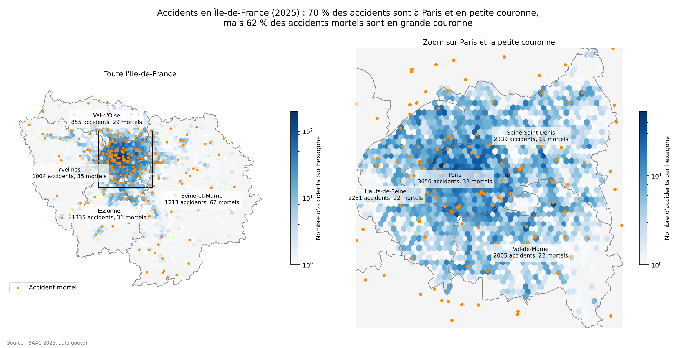
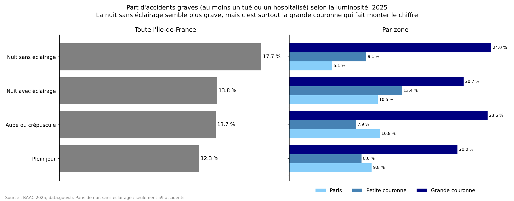

# TP Dataviz : lisibilité et accidents de la route en Île-de-France

## Partie 1 : règles de lisibilité (7 à 16)

### Règle 7 : étiquettes et graduations lisibles
- **Problème :** trop de graduations ou des étiquettes trop petites / penchées, on galère à lire l'axe.
- **Correction :** espacer les graduations, agrandir le texte, et plutôt simplifier le graphique (barres horizontales) que pivoter les étiquettes.
- **Chez moi :** sur mon dashboard Vélib', l'axe des arrondissements affichait 0-5-10-15-20 au lieu des numéros, il fallait compter les barres.

### Règle 8 : couleurs accessibles
- **Problème :** trop de couleurs ou des couleurs trop proches, les catégories se mélangent (surtout pour les daltoniens).
- **Correction :** peu de couleurs, bien distinctes (bleu / orange plutôt que rouge / vert).
- **Chez moi :** le treemap des plateformes (dashboard jeux vidéo) avait une trentaine de couleurs, ça n'apportait rien.

### Règle 9 : étiquetage direct
- **Problème :** une légende à part oblige à faire des allers-retours entre le graphique et la légende.
- **Correction :** écrire le nom ou la valeur directement à côté de la donnée.
- **Chez moi :** mon camembert du 11/09 n'avait aucun pourcentage sur les parts.

### Règle 10 : éviter le chartjunk
- **Problème :** 3D, ombres, bordures, grilles chargées, ça ajoute du bruit.
- **Correction :** enlever tout ce qui n'aide pas à comparer.
- **Chez moi :** mon graphique en barres 3D du 11/09, la perspective faussait les hauteurs.

### Règle 11 : trop de catégories
- **Problème :** avec trop de catégories, on passe son temps à lire les étiquettes.
- **Correction :** regrouper, filtrer ou faire plusieurs petits graphiques.
- **Chez moi :** camembert avec plus de 10 parts et treemap à ~30 plateformes, j'aurais dû garder un top 5 + "Autres".

### Règle 12 : trier les barres
- **Problème :** des barres dans le désordre, on ne voit pas tout de suite le max et le min.
- **Correction :** trier par valeur, sauf s'il y a un ordre logique (mois, tranches d'âge...).
- **Chez moi :** les ventes par genre (jeux vidéo) étaient triées, c'était bien.

### Règle 13 : points superposés
- **Problème :** trop de points qui se chevauchent, on ne voit plus où c'est dense.
- **Correction :** transparence, hexbin ou agrégation.
- **Chez moi :** la carte Vélib' (~3 800 accidents + 988 stations) faisait une grosse tache au centre.

### Règle 14 : décimales
- **Problème :** trop de décimales, ça ralentit la lecture et ça fait faussement précis.
- **Correction :** entiers pour les comptages, une décimale pour les pourcentages.
- **Chez moi :** "Taux accidents 11,29" sur le dashboard Vélib', 11,3 suffisait.

### Règle 15 : dates
- **Problème :** les axes de dates se surchargent vite.
- **Correction :** moins de graduations, format court ("janv."), pivoter seulement en dernier recours.
- **Chez moi :** pas de dates dans ce TP (j'ai choisi la luminosité), donc pas appliquée ici.

### Règle 16 : économie visuelle
- **Problème :** vouloir tout montrer noie le message.
- **Correction :** un graphique = un message, idéalement écrit dans le titre.
- **Chez moi :** le titre du dashboard Vélib' donnait déjà la conclusion, je l'ai refait ici.

## Partie 2 : accidents corporels en Île-de-France (2025)

### Données
Base BAAC 2025 (data.gouv.fr). J'ai pris l'Île-de-France et j'ai utilisé 2 fichiers :
- `caract-2025.csv` : un accident par ligne 
- `usagers-2025.csv` : une personne par ligne 

### Nettoyage
- 55 093 accidents en France, dont 14 760 en Île-de-France
- conversion de `lat` / `long` (virgule remplacée par un point) puis projection en Lambert 93
- suppression de 72 accidents dont les coordonnées tombent hors de leur département
- gravité de l'accident = celle de la victime la plus touchée. Un accident est **grave** s'il y a au moins un tué ou un blessé hospitalisé
- luminosité : 5 catégories ramenées à 4 (les deux cas de nuit sans lumière regroupés)

Au final : 14 688 accidents, dont 252 mortels et 1 929 graves.

### Carte

À gauche toute la région, à droite un zoom sur Paris et la petite couronne. La couleur donne le nombre d'accidents par hexagone (échelle log), les points orange sont les accidents mortels.

### Comparaison selon la luminosité

À gauche la part d'accidents graves selon la luminosité, à droite la même chose par zone.

### Interprétation

| Zone | Accidents | Accidents mortels | Part d'accidents graves |
|---|---|---|---|
| Paris | 3 656 (24,9 %) | 32 (12,7 %) | 10,0 % |
| Petite couronne | 6 625 (45,1 %) | 63 (25,0 %) | 9,6 % |
| Grande couronne | 4 407 (30,0 %) | 157 (62,3 %) | 21,0 % |

- Les accidents sont surtout à Paris et en petite couronne (70 %), et sur le zoom on voit que c'est dans Paris que c'est le plus dense.
- Mais les accidents mortels sont surtout en grande couronne (62 %). Là-bas, un accident sur cinq est grave, contre un sur dix à Paris et en petite couronne. La Seine-et-Marne a relativement peu d'accidents (1 213) mais c'est le département avec le plus d'accidents mortels (62, presque 2 fois plus que Paris).
- Mon hypothèse : on roule plus vite hors agglomération (routes à 80 ou 90 km/h), donc les chocs sont plus violents. Je ne peux pas le prouver, la vitesse n'est pas dans les données.
- Pour la luminosité, la nuit sans éclairage a l'air plus dangereuse (17,7 % d'accidents graves contre 12,3 % en plein jour). Mais 59 % de ces accidents ont lieu en grande couronne. Zone par zone, la lumière change peu de chose (en grande couronne : 20,0 % le jour, 24,0 % la nuit sans éclairage). C'est surtout le lieu qui compte.

### Règles appliquées
- **7** : barres horizontales pour que les libellés soient lisibles à plat
- **8** : un dégradé de bleus + un orange pour les accidents mortels (couleurs distinguables par les daltoniens)
- **9** : noms et chiffres des départements directement sur la carte, valeurs au bout des barres
- **10** : pas d'axes sur la carte, pas de grille ni de cadre
- **11** : luminosité passée de 5 à 4 catégories, départements regroupés en 3 zones
- **12** : barres triées par part d'accidents graves
- **13** : hexagones au lieu de 14 688 points superposés, seuls les accidents mortels restent en points
- **14** : nombres entiers et pourcentages à une décimale
- **16** : chaque graphique a un titre qui donne la conclusion

