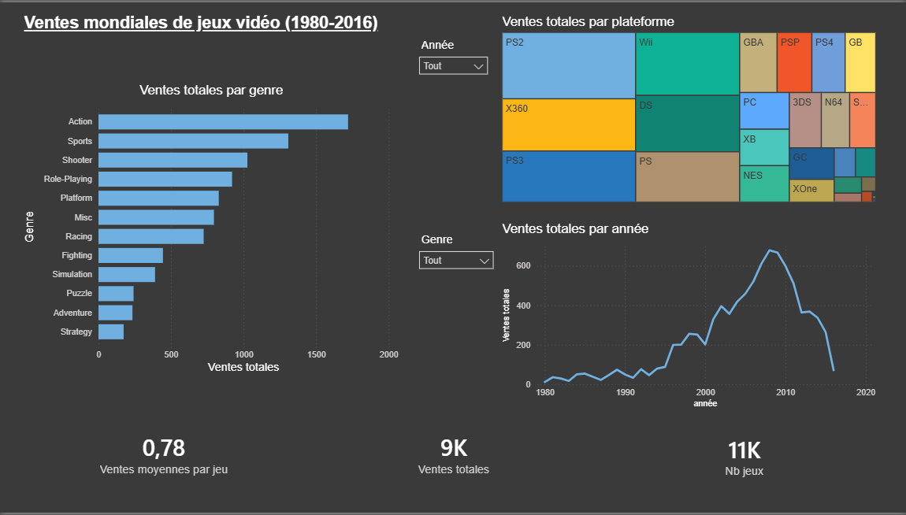

# Dashboard Power BI : ventes de jeux vidéo

Dashboard interactif réalisé avec Power BI à partir du dataset Kaggle "Video Game Sales" (ventes de jeux vidéo de 1980 à 2016).

Il contient :
- les ventes par genre (barres)
- les ventes par plateforme (treemap)
- l'évolution des ventes par année (courbe)
- trois indicateurs : ventes totales, nombre de jeux, ventes moyennes par jeu
- deux filtres : année et genre

On y voit que les ventes ont leur pic vers 2008, que l'Action est le genre le plus vendu, et que la PS2, la Xbox 360 et la PS3 dominent les plateformes.
